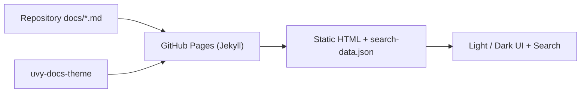

# Mermaid and search

## Live-themed Mermaid diagrams

When `mermaid.version` is configured in `_config.yml`, fenced `mermaid` code blocks load Mermaid on demand (only on pages containing diagrams) and bind colors to `--uvy-*` tokens. Toggling between light and midnight-slate dark mode re-renders diagrams automatically to match the active palette.

## Full-text search

Every site automatically builds `/assets/js/search-data.json` from its Markdown pages and configured collections using Liquid — no external build pipeline or Ruby search plugin is required.

- Press `/` from anywhere on the page to jump straight to the sidebar search input (opening the navigation drawer automatically on mobile).
- Queries match across page titles, `H2`/`H3` section headings, and body text, linking directly to matched section anchors when available.
- Use `ArrowDown`, `ArrowUp`, and `Enter` to open a result, or press `Escape` to clear the query and restore the navigation tree.
- Without JavaScript, the search input stays hidden and the full navigation tree remains accessible.
